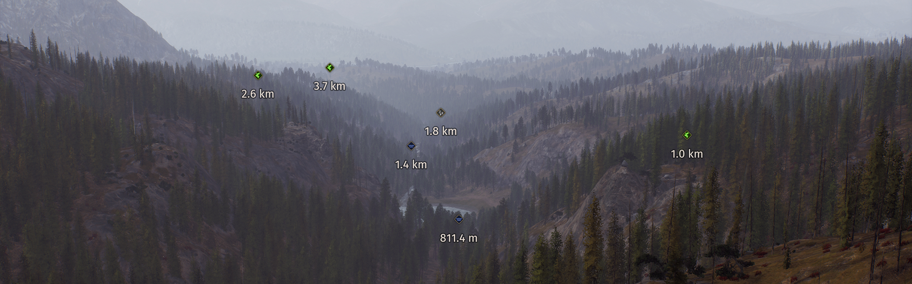
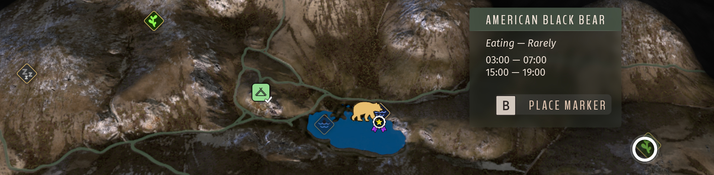
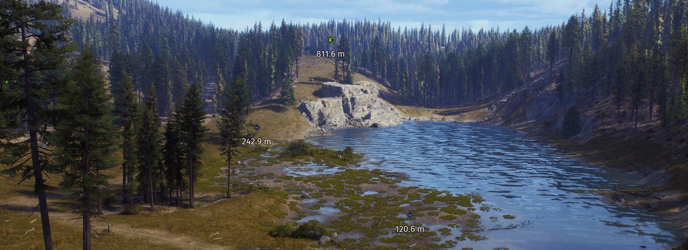
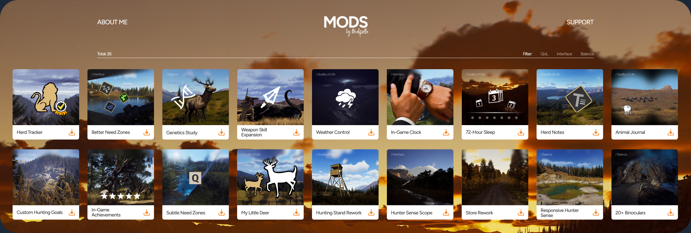

# Better Need Zones — Way of the Hunter Mod

By Mahpella

A need-zone navigation and map interface mod for Way of the Hunter. Find discovered feeding, drinking, and resting areas with persistent map pins, first-person markers, usage schedules, and Often/Rarely labels.

## Overview

A zone icon alone does not tell you when animals use the area or how often they visit it. Finding a marked spot again after changing herds can also interrupt a hunting route. Better Need Zones combines usage schedules and frequency labels with persistent map pins and first-person navigation markers, making discovered zones easier to understand and revisit.

## Download & Install

You can download the mod from my [Website](https://mahpella.com/games/way-of-the-hunter/mods/need-zone-marker)
or [Nexus Mods](https://www.nexusmods.com/wayofthehunter/mods/31)

**Installation guide**

### Step 1. Create a backup (optional)

If you wish, copy the Saved folder to another location:  
**Win + R → %LOCALAPPDATA%\WayOfTheHunter**

### Step 2. Open the game folder

Close the game. In Steam, browse the local files for Way of the Hunter and open:  
**WayOfTheHunter\Content\Paks**

### Step 3. Install the mod

Extract the archive and copy all **.pak files into the Paks folder**, replacing older versions if necessary.  
Launch the game and load your save.

## How to Use

- Hover over a discovered feeding, drinking, or resting zone on the map.
- Read its usage-time intervals and Often/Rarely label; rare zones appear more transparent.

- Click Place Marker or press B to mark it.
- Follow the compact first-person marker showing the zone type and distance.

- Marked zones remain available when changing herds or reopening the map, subject to map filters.
- Click Remove Marker or press B again to remove the zone marker.
- Marker appearance persists after a restart; the game's normal waypoint limits still apply.

## Feedback

If you find a bug, have suggestions for improving this mod, or have ideas for new mods, I would love to hear from you.

You can also visit [mahpella.com](https://mahpella.com) to explore mods in development and share your ideas for improving your favorite games.

If you would like to support my work → [Buy Me a Coffee](https://buymeacoffee.com/mahpella)

